# GasMan Provider

GasMan Provider is an iOS application for gas cylinder service providers and delegates. It helps teams manage customer and merchant orders, coordinate deliveries, monitor cylinder inventory, and handle provider operations from one place.

## Features

- **Role-based access:** Choose the Delegate or Service Provider experience.
- **Order management:** View new, current, completed, and return orders, with order status, payment information, address, and item details.
- **Order tracking:** Follow delivery progress and review order totals, payment method, delivery fees, and customer contact details.
- **Delegate management:** View affiliated delegates and their contact details; review delegate information, reports, and settlement data.
- **Inventory and stock tracking:** Monitor steel and fiber cylinders, including quantities that have exceeded the configured period.
- **Availability and provider operations:** Set availability for receiving orders and access reports, invoices, wallet, and delegate registration requests.
- **Service area management:** Review work locations and add neighborhoods to the provider's coverage area.

## Screenshots

### Shared entry screen

| Role selection | Choose the Delegate or Service Provider experience |
|---|---|
| 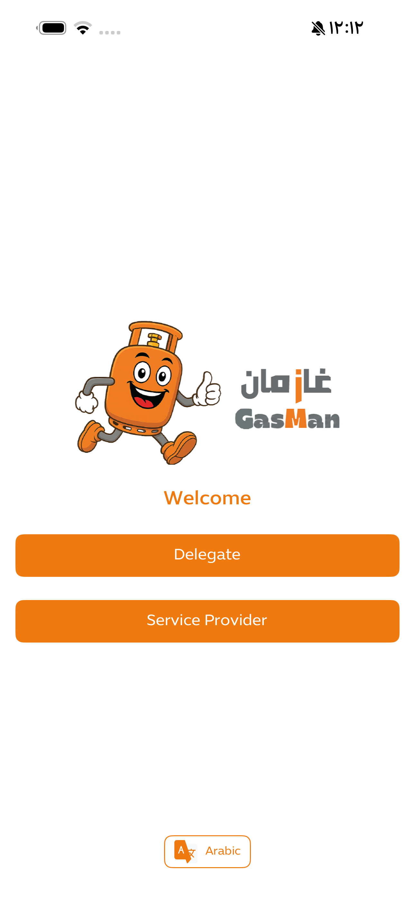 | |

### Service Provider app

| Screen | Description |
|---|---|
| 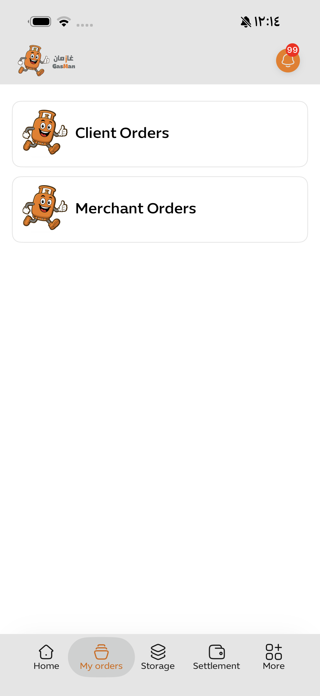 | Provider home screen with Client Orders and Merchant Orders. |
| 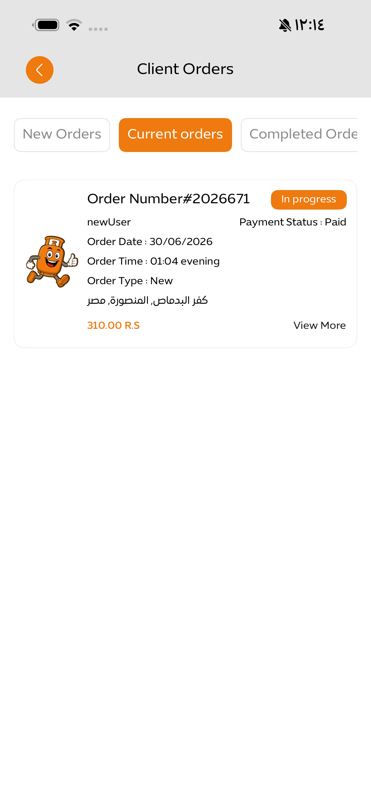 | Client order list with status and order details. |
| 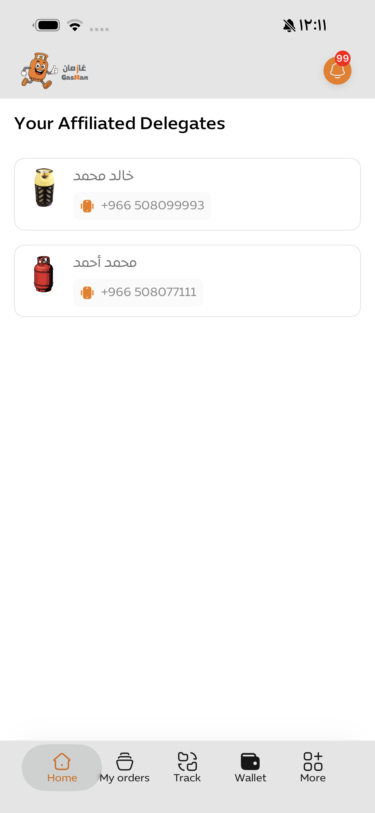 | Provider's affiliated delegates and contact details. |
| 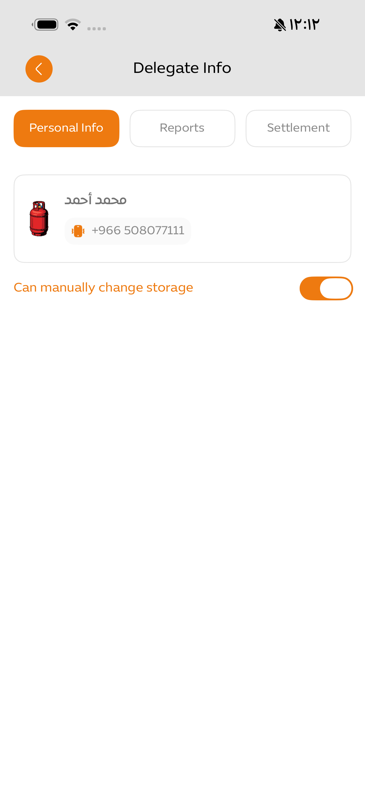 | Delegate profile, reports, settlement, and manual storage control. |
| 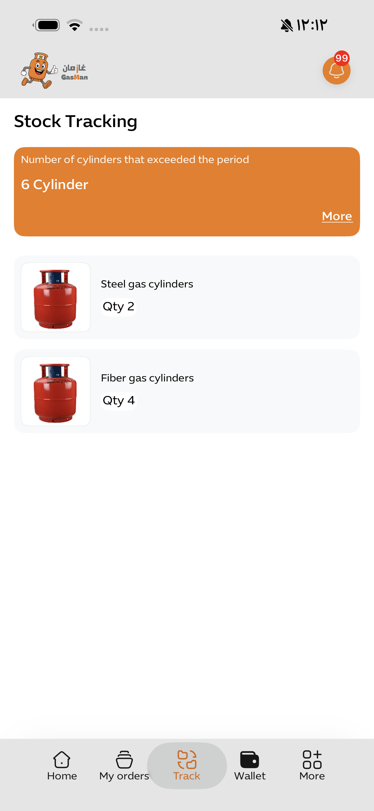 | Cylinder inventory and stock age overview. |
| 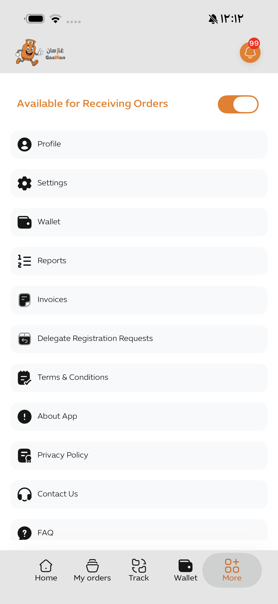 | Provider availability, reports, invoices, wallet, and delegate requests. |
| 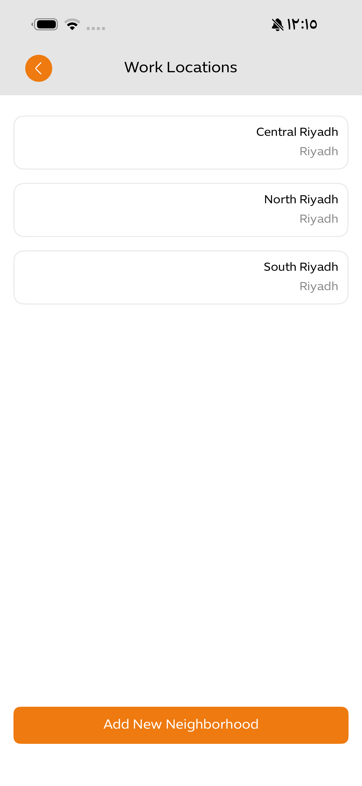 | Provider work locations and neighborhood management. |

### Delegate app

| Screen | Description |
|---|---|
| 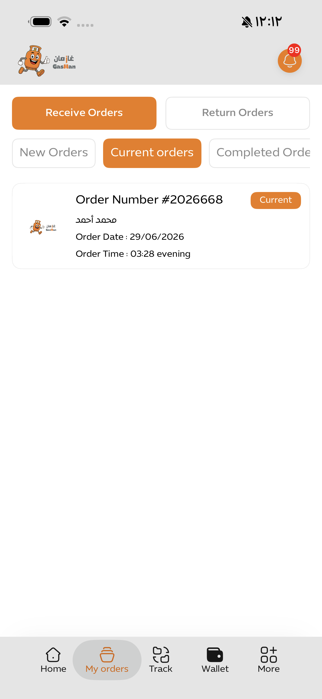 | Delegate order inbox, including receive and return orders. |
| 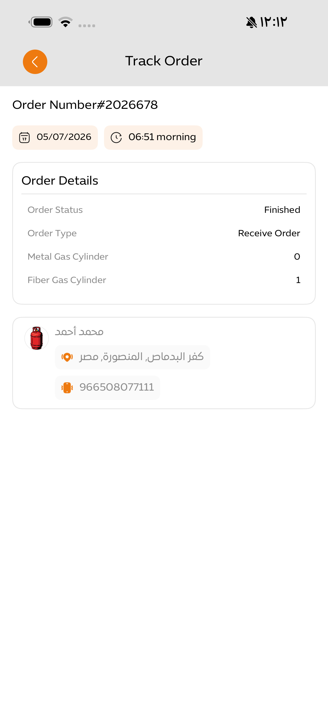 | Delegate view of a completed delivery and its order summary. |
| 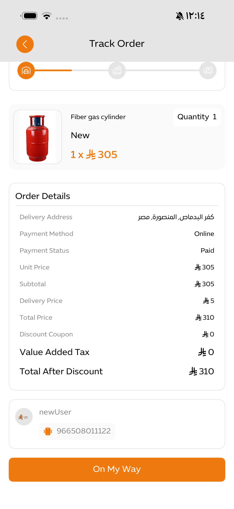 | Delegate delivery progress, customer details, and payment breakdown. |

## Technology

- Native iOS application built with Swift and Xcode.
- The project integrates Firebase, Google Maps, and Alamofire.

## Project structure

The Xcode project is `GasmanProvider.xcodeproj`. Application source code and resources are organized under the `GasmanProvider/` directory.

## Getting started

1. Open `GasmanProvider.xcodeproj` in Xcode.
2. Resolve the project's Swift package dependencies if Xcode prompts you to do so.
3. Select the appropriate app scheme and an iOS simulator or connected device.
4. Build and run the application from Xcode.

> Some integrations may require project-specific Firebase configuration and API credentials. Use the configuration supplied by the project maintainers.
